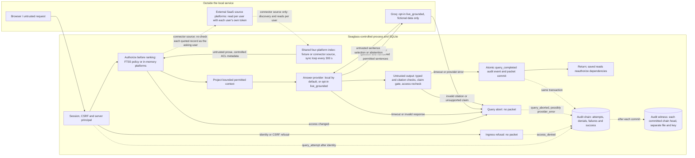
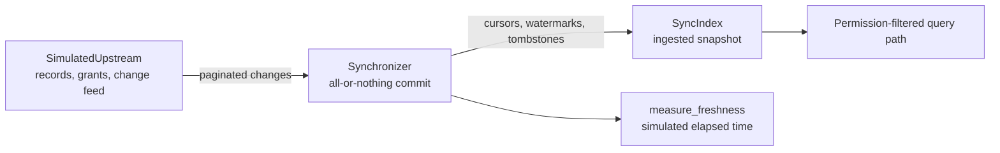
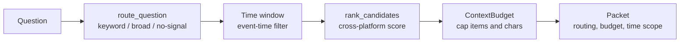
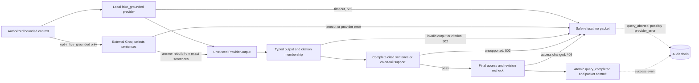

# Architecture

The application runs as one local Python process with a SQLite database. FastAPI handles
HTTP requests, Pydantic validates inputs, and Jinja2 with JavaScript renders the interface.
The travel-policy demo reads Markdown and controlled JSON metadata from `data/demo/`.
The four-platform route keeps one shared in-memory index per process, filled either from a
fictional fixture or, through the connectors, from real Confluence, Jira, Slack and Drive
accounts, and kept fresh by a sync loop. The travel-policy route uses SQLite/FTS5. The
[submission diagram](submission/architecture-trust-boundary.svg) shows both local
stores, the opt-in live model path and the current scope.

## Trust boundaries

The server resolves identity; browser input and source text cannot grant permissions.
An operator who controls the local files or keys can alter the trusted environment.
The dashed audit arrows show that refusal and failure are recorded too. An ingress refusal
records `access_denied` before `QueryService` starts; a successful principal enters the query
path and records `query_attempt` before retrieval. Provider output crosses back into the
release gate as untrusted data. Local provider modes make no external call. Only the opt-in
`live_grounded` mode crosses to Groq, sending the question and numbered permitted sentences; the
model's sentence selection comes back as untrusted data and the answer is rebuilt locally from
those exact sentences. With the connector source, the service crosses to the platforms twice: the
sync loop reads what each user can see with that user's own token, and the query path asks the
platform again about each record before quoting it. If audit persistence itself fails, the service refuses release and cannot guarantee
that a failure event was recorded. A stopped query records what it retrieved with its terminal
event. After each commit the chain head is written to the audit witness, so removing the newest
events from the database alone fails verification (removing them from the witness too needs an
external checkpoint to detect). Protected officer inquiry remains a separate audit-role path.

## Travel-policy request flow

1. Resolve a signed session's user ID against the current server-side principal row. Re-read active state, tenant and roles; ignore caller role/tenant claims.
2. Persist a minimised audit attempt and capture current principal state plus tenant ACL/content revisions.
3. Retrieve readable approved chunks with tenant, role, effective-date and explicit scope predicates inside the database query before ranking/limit. Resolve the complete authorised applicable rule catalogue separately from text top-k.
4. Evaluate structured rules deterministically. Resolve only explicit comparable scoped overrides/supersession, identify unresolved competing values or incompatible units/currencies, and check required workflow evidence and case inputs.
5. Select bounded permitted passages for the provider and recheck the captured state. The offline provider explains the computed result using actual excerpts.
6. Validate typed provider output and citation IDs against exactly the supplied evidence. Recheck revisions. A provider cannot supply authoritative outcome fields.
7. In a write transaction, recheck access, append the final audit event, and persist the owner-restricted packet with every contributing source dependency. Return the packet only after commit.

The packet schema includes request/audit IDs, answer and citations, applied rules, conflicts, missing evidence, review route, provider mode, case outcome and scope notice. Saved packet reads and exports reauthorize its owner and all dependencies. There is no shared answer cache or conversation memory.

## Storage and source provenance

`db/` validates controlled imports, creates the versioned schema, and rejects incompatible existing schemas. Principals, logical documents, versions, chunks, rules and tenant revisions have explicit identities. Version content has a SHA-256 digest; chunks carry stable IDs, hashes and heading/paragraph locators. Rule metadata links to a real source passage. Imports reject conflicting identifiers, missing ACLs, invalid scopes/dates, cross-tenant links and invalid relationship graphs. Existing immutable version content is preserved.

Metadata is trusted only through the local import/control path. Document prose never sets a role, ACL, approval state, rule value or override. Separate controlled metadata changes update the appropriate tenant revision and audit record. The local CLI is an operator interface with filesystem privileges, not an application user role.

`auth/` centralizes the tenant, active-principal and role/ACL predicate. An administrator role does not bypass source grants. `knowledge/` applies that predicate in SQL. FTS5 is lexical search; it does not provide semantic similarity. If unavailable, the labelled fallback ranks only chunks already selected by authorization. Ranking statistics and unrestricted match counts are not exposed.

## Policy semantics

Historical evaluation means **policy effective on the case date, from evidence available now**. It does not reconstruct what the organisation knew at that past time. Fixture business dates are interpreted in `Asia/Singapore`; validity is `[valid_from, valid_to)` with an optional open end. Approval is separate from supersession: an approved predecessor remains eligible for its own historical interval. Draft, withdrawn and not-yet-effective versions are excluded from answer evidence; explicitly readable history can show their states.

The supported scope dimensions are jurisdiction, worker type, project and cost centre. Exact scope matches are required; missing decisive fields produce review. Case outcomes concern the supplied scope and readable rule catalogue. Undeclared cost-centre restrictions cannot be certified. The contractor workflow publicly requires contract verification regardless of whether any contract record exists; absent and inaccessible terms produce the same safe explanation.

All applicable rules are evaluated independently of top-k retrieval. Explicit relations can resolve competing caps within their declared scope. Unrelated jurisdictions do not conflict. Incompatible currencies/units require review; there is no FX conversion. Decimal-compatible nonnegative finite monetary inputs are required. General guidance is not a certification of a complete contractor claim.

## Simulated platform queries

`platforms/simulated.py` checks each platform's grants before ranking its permitted
records. The caller can still supply the platforms a query requires, but by default the
service routes the question itself (see below) and also searches every other platform the index
serves. Results use lexical matching and are ranked across platforms. Stale or failed sources
produce a partial answer or an abstention. Permission, version and hash checks also protect saved
packet reads.

`platforms/focus.py` turns the ranked, permitted records into an answer. It extracts the
question's content terms and counts how many the evidence covers; under 75% the service abstains.
Otherwise it selects passages (short paragraphs, list items, field lines, table rows) that cover the
terms, gives each other strongly matching record its best passage, and adds each quoted record's
title and, for an issue, its status line. Sentence boundaries come from
`providers/segments.py`, the same definition the claim gate uses, so every selected passage is a
complete source sentence the gate accepts. A live model is given every matching passage instead and
picks its own sentences.

When the service is built with a verifier (the typed route always is), each record about to be
quoted is checked with its source first: `denied` drops it, and `changed` or `unverifiable` drops
it and marks its platform incomplete. Saved-packet reads run the same check on every cited record.

## Simulated synchronization (G2)

`platforms/sync.py` adds a deterministic pipeline between upstream fixture state and the
queryable snapshot:

`SimulatedUpstream` holds what each platform currently has and records every create, update,
delete and ACL change with a monotonic revision. It exposes pagination and can simulate rate
limits, expired access and a dropped connection. `SyncIndex` is a `SimulatedPlatformState`
subclass, so the existing permission, freshness and packet checks are unchanged; it adds
cursors, tombstones and a sync log. `Synchronizer` stages a whole run and commits records,
grants and tombstones together, advancing the cursor and the `last_successful_sync` watermark
only on a complete run. The cursor stops at the highest revision actually applied, so a
change appended mid-run stays pending. While any change is pending, `source_status` reports
`stale`, so un-ingested upstream content is never presented as current. Tombstoned records
leave the snapshot entirely, which denies both new queries and saved-packet reads.

Grant maps stay platform-specific: Confluence space+page, Jira project+issue, Slack
channel/thread/DM, Drive folder/file. `measure_freshness()` records mutation, ingestion and
observed-answer times against a declared budget and labels them `simulated_elapsed`;
wall-clock and live propagation remain unmeasured in that function. See the
[stage report](stage-report-2026-09-27.md) for the acceptance criteria and evidence.

## The running index and the connector source

`platforms/runtime.py` holds the shared index the typed route reads. `PlatformRuntime.sync_all`
polls each upstream and runs the synchronizer, and `run_forever` repeats that every
`ASPIRE_SYNC_INTERVAL_SECONDS` (300 by default, which must be shorter than the 3,600-second
freshness budget). Each completed sync records how long pending changes took to arrive, in real
elapsed seconds, or, on the connector source, from each platform's own modified time.

`platforms/connected.py` provides `ConnectorUpstream`, which presents real platforms through the
same change-feed interface as `SimulatedUpstream`. A poll crawls every configured container once
per application user, with that user's token: `discover` lists the pages of a Confluence space, the
issues of a Jira project (`/rest/api/3/search/jql`), the Slack channels the user belongs to and
their threads, and the text files of a Drive folder. Items a user can read become that user's
grants in the platform's own grant maps. The poll publishes the difference from the previous crawl
as upsert, delete and permission changes, all or nothing: if any user's crawl fails, nothing is
published and the sync reports the failure category. `verify` re-reads one record as the asking
user at query time. On Slack it confirms channel access only; an edited message arrives at the next
sync.

The connectors were checked once against real test accounts
([live access check](reviews/live-access-2026-10-14/README.md)). The integrated path has offline
tests against a stateful fake of all four APIs and a manual check in
[`eval/live_platform/`](../eval/live_platform/README.md) that has not been run yet.

## Question routing, ranking and context bounds (G3)

`platforms/routing.py` decides *which* platforms a question needs and how their permitted
evidence is assembled:

`route_question` picks platforms from keyword signals, an explicit platform mention, a
broad-question default or a no-signal default; it records the basis, the signals and the
**omitted** platforms with a coverage note, so a keyword miss is never presented as
completeness. An explicit caller-supplied tuple is still honoured
(`basis="explicit_override"`) for deterministic tests and the case demo. `rank_candidates`
scores permitted candidates across platforms as `10 × term_hits + 5 × source_id_hits + 3 if
the platform is named`, breaking ties on `(platform, source_id)` and excluding stopwords, so
the order is not merely per-platform concatenation. Ranking only ever sees permitted
candidates. `ContextBudget` caps total items and characters; `apply_budget` degrades
deterministically and records what was dropped, and a required platform that is
budget-excluded forces an explicit `partial` or `abstained` result. `TimeWindow` is a
half-open, timezone-aware `[start, end)` interval applied to each record's **event/creation**
time (`event_at`); `source_updated_at` is not used as a substitute. The packet records the
routing decision, the budget outcome and the time scope applied.

## Audit and provider boundaries

`audit/` serializes tenant-local appends using SQLite transactions and unique sequence constraints. Canonical event payloads, a schema/domain tag and previous HMAC bind the chain. A separate generated key stays outside the database. Checkpoints identify tenant, schema, key, sequence and head HMAC. Read [security](security.md) for the limits of these guarantees.

Protected simulated queries also store encrypted questions, answers, retrieved IDs and
per-document decisions through `audit/protected.py`. A separate AES-GCM key protects
these payloads. The officer inquiry checks the caller's audit role and tenant, verifies
integrity, and filters records by user, platform, space/document and time. This coverage does
not extend to the original travel-policy queries. Ordinary saved packets still contain answer
text in SQLite; see [security](security.md) for storage and completeness limits.

`providers/` defines the `AnswerProvider` interface, the default `OfflineExtractiveProvider`,
the local `GroundedAnswerProvider` and the opt-in `LiveGroundedProvider` (`providers/live.py`).
The application limits provider input, validates citations, enforces timeouts and records safe
errors. Local modes remain the default and record live fields as `not_run`.

`live_grounded` is built only for the approved Groq target and limits, with a key file kept
outside the project (mode 0600) and a spend ledger; any other target or looser setting is refused
before a request is made. It sends only the question and the permitted evidence split into
numbered sentences, never identity, tenant, roles, ACLs, audit or document identifiers, or
locators. On the platform path, sources classified as restricted are withheld even when the asker
may read them. The model returns the sentence numbers that answer the question, or abstains. The
provider assembles the answer from those exact sentences behind service-authored labels, so
model-written prose never reaches the user, and the claim-support gate still runs on the result.
Every attempt is reserved in a file-locked ledger before any byte is sent; there are no retries,
and failures are stored only as fixed categories. An abstention is audited as `provider_error`
(`model_abstained`). On the policy route, if the service's own decision is `needs_review` or
`insufficient_evidence`, it releases that decision with no citations; if the decision is
answerable, the request fails closed with 422. The platform path returns an abstained result that
requires human review. Only fictional demo data is approved for this mode. The manual evaluation harness
is [`eval/live_model/`](../eval/live_model/README.md), which records the 14 October 2026 runs as
they happened: provider rate limits stopped every run, so no model-quality result is claimed.

The earlier, separate 5E synthetic preflight observed a corrected Groq HTTP 200 and a readable packet through an injected service
path. Its raw vendor response body was not retained, human acceptance remains pending, and the
business outcome is `needs_review / undetermined`. See the
[5E evidence](reviews/stage5e-preflight-2026-10-10/README.md) and
[human checklist](reviews/stage5e-preflight-2026-10-10/HUMAN-ACCEPTANCE.md).

The newer [connector fixture work](fintech-connector-fixtures.md) has bounded HTTP adapters,
offline fixture loading and a mock bridge into the query/audit path. The default web app does
not ingest that bundle automatically. Live identity mapping, platform API compatibility,
synchronization and revocation remain to be verified. The
[5F checklist](reviews/stage5f-preparation-2026-10-10/CHECKLIST.md) records the separate human
finding and batch authorization needed before the planned live replay.

## Grounded provider, claim support and audit retention (G4)

The grounded provider reasons only over the already-bounded, already-permitted evidence it is
given; it cannot receive unreadable content, introduce a source identifier or set an outcome
field. A real runtime needs a `ProviderRuntimeConfig` that is both **enabled and entitled**;
otherwise construction is refused before any request. `ProviderRuntimeRecord` stays all-null for
a local run, so a simulated answer can never look like a live one.

`evaluate_claim_support` checks each claim against **one** cited source and releases it only when
the claim matches a **complete source sentence or its complete colon tail**, after case and
whitespace normalization (`method="exact_cited_span"`). It may first strip an exact
service-authored citation label such as `Evidence (locator):`. This bounded quotation rule
rejects arbitrary substrings, including missing numeric prefixes, signs, currencies, units and
negation. A locator or identifier token alone cannot support a factual claim. The report's
lexical-overlap ratio is a **diagnostic proxy only**. The method reports a denominator and a
`simulated`/`live` label, fails unsupported claims closed, and rejects a `live` label for a local
provider. The query service refuses an unsupported answer before packet persistence. This proves
bounded extractive support for the quoted text; it does **not** prove source truth or semantic
entailment, and a supported paraphrase can still be refused.

`RetentionPolicy` bounds protected payloads by age and entry count. `apply_retention` is
tenant-scoped and dry-run by default; applying it removes only the encrypted payloads — never the
HMAC chain — and records the removal atomically, with a tombstone digest bound into the chain so a
forged tombstone cannot mask a deletion. The officer inquiry reports the retention state and the
checkpoint-anchoring limit (`verified_through_checkpoint`, `unanchored_tail_events`,
`completeness_unproven`): an unanchored tail is not a completeness proof. It also pages: a
matching set larger than the page size returns a signed, tenant- and filter-bound continuation
cursor (`next_cursor`), stable `(timestamp, request ID)` ordering, and `has_more`, so an officer
can traverse every match without loss at equal timestamps.

## Retrieval cap and event-time scope

Per-platform retrieval authorizes first, then applies the requested **event-time scope**, and only
then applies a bounded per-platform cap (`DEFAULT_RETRIEVAL_CAP = 50`) to the survivors before the
final cross-platform ranking. Truncation is therefore never allowed to hide a recent permitted
match behind older ones, and the packet records a `retrieval` report
(`candidates_after_scope`, `retained`, `truncated`, `any_truncated`) so a reader can see whether
the cap bound the result. Every source-derived outward field — answer text, citations, time-scope
metadata and context-budget metadata — is derived from the same authorized, dependency-checked
record set, so a revoked source cannot survive in any of them.

## Interfaces and scope

The browser views are Ask (`/`), Sources (`/sources`), Policy history (`/policies`), Audit
(`/audit`) and Case demo (`/cases`). Protected JSON endpoints cover queries, source and
history reads, packet exports, case execution and officer inquiry. Only packaged CSS and
JavaScript are served as public static files; corpus files and runtime data stay private.

Templates and static assets load from the installed Python package. Configuration loads
from the working directory or the CLI's `--root` directory. The supported runtime is one
local process. Production identity and live connector integration remain open, and the live
model mode is limited to fictional data;
the application does not execute financial actions or accept public document uploads.

## General questions and bounds

The deterministic catalogue is used for the explicit contractor workflow and bounded
travel-cap questions. Other general questions quote lexical matches with an explicit
inspection notice; absent matches yield insufficient evidence. This routing is a small
domain heuristic, not arbitrary policy extraction or semantic question understanding.
Case dates and decisive claim fields always come from validated structured input.
Stopwords are excluded from FTS queries so incidental words alone do not create answers.
Packets record the retrieval mode, top-k, context budget and provider timeout. The service
constructor exposes bounded top-k/context settings; excessive catalogue evidence aborts
for review rather than silently dropping competing rules.
