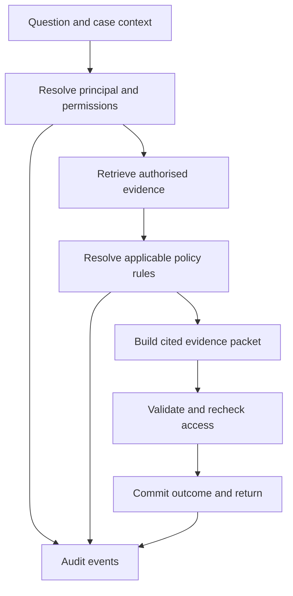

# Aspire Internal Brain — project skeleton and delivery plan

Prepared: 23 September 2026. Working environment: PyCharm; Python application developed and tested locally.

**Post-P0 update, 25 September 2026.** The supplied `docs/stage-report-2026-09-25.md` from the `fef5` worktree finds the offline P0 complete within its synthetic-fixture scope and the supplied FinTech case still unmet. Its 149-test result belongs to that worktree; this checkout's `docs/progress.md` records an earlier 148-test run. Reverify the working checkout before using either number as current evidence. Sections 1–6 and the S0–S8 table preserve the original P0 design; the revised post-P0 gates in §§7–8 supersede the former short P1 schedule. `prompt.md` remains the historical P0 execution prompt.

## 1. Project decision

Build a permission-aware enterprise knowledge assistant. **Authorised retrieval is the backbone; policy versioning, conflict detection, and an audit engine support every answer.**

The product helps an employee understand which internal guidance applies to a particular operational question, what evidence supports the answer, and when a human needs to resolve uncertainty. Its output is a cited evidence packet, not permission to execute a payment or change a card limit.

The organiser’s public event page identifies Aspire’s challenge as an internal knowledge system with RBAC, security logging, and an audit trail, and lists **16 October 2026** as the submission deadline. The page does not establish the exact cutoff time, full judging rubric, mandatory runtime services, or submission-file requirements. Verify those against the participant brief before finalising the submission. [S1]

This plan implements the direction selected in the conversation. It does not reuse the earlier reports’ rankings, perfect scores, performance claims, or claims of regulatory compliance.

### What makes this useful

The intended distinction is an inspectable workflow: **who can see the evidence, which policy applied on the relevant date, whether the evidence conflicts, and how the answer was produced**. These are design goals to demonstrate, not claims that permission-aware search or audit logging are new inventions.

## 2. Scope and assumptions

| Item | Planning assumption |
|---|---|
| Developer capacity | One student developer, assisted by Codex; no assumed three-person team |
| Hardware | Ordinary laptop; the previously discussed M4 MacBook Air with 16 GB is sufficient as a planning target; verify the actual environment |
| Working style | Small reviewable milestones in PyCharm; no local model training or GPU requirement |
| Data | Synthetic documents and identities only; fictional company policies clearly labelled |
| Initial corpus | About 12 logical documents / 16–20 versions, plus deterministic test fixtures |
| Demo workflow | Singapore contractor travel-expense guidance, with structured case fields |
| Supported ingestion | Local Markdown/text plus validated JSON metadata through a CLI |
| Skeleton outcome | A running application with real retrieval, access checks, policy logic, audit verification, and tests |
| Language generation | Offline extractive/template mode first; a provider interface for a later verified Tencent runtime integration |
| Estimates | Focused engineering hours, including review and debugging; not model generation time or guaranteed completion time |

**P0 skeleton boundary:** OCR, bank integrations, payment execution, card-limit changes, autonomous tool use, public document uploads, Slack/Drive connectors, SSO, model training, vector-database infrastructure, and a general legal-policy reasoning engine were excluded from the offline skeleton. The attached case makes four-platform ingestion and source permissions necessary for the next stage; the P0 exclusion does not apply to that work.

## 3. Demonstration and expected behaviour

Use the same fictional case throughout: a contractor proposes a **SGD 220 travel claim for project P17 on 10 September 2026**.

| Scenario | Expected behaviour |
|---|---|
| Employee asks for the general travel cap | Cite the applicable general policy: SGD 250 per claim after 1 September |
| Employee asks whether this contractor claim is within all applicable limits | Return `needs_review`: the public workflow requires verified contract terms, which this principal cannot establish from available evidence; reveal no restricted title, value, or existence count |
| Finance lead asks about the same case | Retrieve an authorised contract addendum limiting P17 to SGD 150, apply its explicit approved override, and report that SGD 220 exceeds the documented limit |
| User changes the expense date to 20 August | Select the old SGD 200 general policy, subject to the same contract-evidence requirements |
| Two equally authoritative applicable rules disagree | Show a conflict to principals who can read both sources; return `needs_review`; do not choose by similarity score or latest upload |
| Document contains instructions to reveal confidential records | Treat it as untrusted source text; no tool execution, role changes, or unauthorised retrieval; record the tested outcome without promising universal injection resistance |
| Auditor inspects the query | Show permitted operational metadata and integrity status; audit access does not automatically grant access to source documents or answer bodies |
| A contributing source is revoked after an answer | Subsequent source and packet requests are denied; no claim that a previously downloaded copy can be recalled |

All caps, dates, contracts, roles, and approval routes above are **synthetic fixtures**, not Aspire’s real policies.

## 4. Architecture and stack

Use a small Python modular monolith: one backend process, one local database, one browser interface.

| Layer | Choice | Reason and boundary |
|---|---|---|
| Runtime | Python 3.12, project `.venv` | Conservative target; check installed interpreter and dependency compatibility |
| Web/API | FastAPI and Pydantic | Typed request/response contracts and central dependencies |
| UI | Jinja2 templates, CSS, minimal JavaScript | One Python project and one server; no separate frontend build. FastAPI documents template support. [S3] |
| Persistence | SQLite with SQLAlchemy | Easy local startup; schema-version check and idempotent seed command |
| Search | SQLite FTS5 lexical search behind a `Retriever` interface | Working baseline before adding semantic retrieval; check FTS5 availability. [S4] |
| Policy engine | Typed Python rules plus immutable policy-version records | Transparent date, scope, and precedence decisions |
| Audit | Structured events, per-tenant HMAC chain, verification CLI | Demonstrate detectable tampering within an explicit threat model |
| Generation | `AnswerProvider`; offline implementation and external-provider boundary | The application remains usable without credentials |
| Quality tools | pytest, HTTPX test client, Ruff | Behavioural tests for the security and domain contracts |
| Packaging | `pyproject.toml`, exact tested dependency lock, `.env.example` | Reproducible setup without committed secrets |

FTS5 is a retrieval engine, **not an access-control system**. The repository query must join authorised document/version identifiers and apply tenant and ACL predicates before returning candidates or applying the final result limit. The application must not fetch unrestricted top-k results and then rely on the model to hide them. Do not expose global match counts or search scores that describe inaccessible records.

If FTS5 is unavailable, implement a labelled deterministic lexical scorer over the already-authorised corpus for this small demo. Never silently remove the permission predicate to make search work.

### Request path



Audit the attempt before external generation or evidence disclosure. Commit the final outcome before returning the answer. The diagram summarises responsibilities; it does not permit audit writes to be best effort.

## 5. Core contracts

### 5.1 Identity and permissions

Use tenant isolation plus RBAC and document ACLs. Source text, request-body fields, and LLM outputs cannot assign roles.

| Principal | Knowledge access | Additional capability |
|---|---|---|
| `employee` | Explicitly granted staff guidance | Own permitted evidence packets |
| `finance_lead` | Staff guidance plus explicitly granted finance/project records | Same packet rules; no universal admin bypass |
| `policy_admin` | Staff guidance and explicitly granted policy records | Policy metadata inspection; no automatic access to finance secrets |
| `auditor` | Staff guidance and explicitly granted documents | Tenant audit metadata and integrity results; source ACLs still apply |
| Other-tenant user | Only that tenant’s grants | Negative test for tenant isolation |
| Disabled user | None | Negative test for principal revocation |

Every active demo principal has an explicit role set stored on the server. A chunk inherits its document-version ACL. Reject incomplete ACL metadata, unknown principals, cross-tenant references, and disabled accounts by default.

P0 uses **local demo identity switching**, visibly labelled. A loopback-only demo endpoint accepts a seeded user ID and creates a server-validated session; it never accepts roles or tenant claims from the browser. Session integrity, CSRF protection for session changes, safe rendering, and no-store response headers are still required. The selector is an impersonation aid, not production authentication. When demo mode is off, protected routes fail closed until a real identity provider is supplied. Public hosting is outside P0.

Enforce access in retrieval, source viewing, policy history, conflict details, packet exports, and audit views. Unknown and inaccessible source IDs return the same outward response. Recheck principal status and ACL/content revision before any external provider call and before returning a completed packet; if relevant state changed, discard the result and require a retry. Describe the remaining in-flight revocation limitation honestly.

Do not add answer caches or conversation memory in P0. Any later implementation must isolate tenants and principals, include permission/content revisions, and revalidate derived content. OWASP’s guidance supports server-side, deny-by-default permission checks on each request; the detailed contracts here are this project’s design decisions. [S5]

### 5.2 Documents and policy versions

Minimum entities:

- `Principal`: ID, tenant, active state, role assignments.
- `Document`: logical ID, tenant, document type, ownership metadata.
- `DocumentVersion`: immutable version ID/content/hash, publication state, publication timestamp, valid-from/to dates, scope, optional supersedes link, provenance and ACL reference.
- `Chunk`: version ID, stable chunk ID, source locator and text hash.
- `PolicyRule`: version ID, rule key, typed value/unit/currency, explicit applicability and optional approved override reference.
- `QueryRun` / `EvidencePacket`: owner, tenant, case context, contributing versions/chunks, rule trace, validated output and run configuration.
- `AuditEvent`: sequence, request ID, event type, safe metadata and chain fields.
- Tenant `acl_revision` and `content_revision` counters updated transactionally on relevant changes.

Version content stays immutable; any publication-state or ACL changes are separate controlled metadata changes with audit events. A new document import creates a version rather than overwriting old text.

Separate the **case date** from the **query time**. For this prototype, historical queries mean “which policy was effective on the case date, using the documents available now.” This is not full reconstruction of what an employee knew at that historical time.

Use half-open effective intervals `[valid_from, valid_to)` and a documented business timezone (`Asia/Singapore` for demo dates). Draft and withdrawn versions are not applicable. Keep publication approval separate from the supersession relationship: a previously approved version superseded today can still apply to an earlier case date. A future policy cannot apply early.

Only trusted fixture/CLI metadata defines role grants, policy approval status, rule values, and precedence. Documents may describe instructions but cannot configure the application. Imported rules should point to the supporting source passage. Show the structured rule beside its evidence so a reviewer can check that relationship.

### 5.3 Conflict detection

Implement a bounded rule engine, not unrestricted natural-language contradiction detection.

1. Select authorised approved policy records relevant to the declared workflow, case date, and explicit scope.
2. Load all relevant authorised rule metadata, not only the top-k search snippets; then retrieve supporting passages.
3. Validate the workflow’s required rule/evidence categories. Missing or inaccessible required evidence produces the same generic unresolved outcome.
4. Normalise typed rule keys, units, currency, applicability, and dates.
5. Apply an explicitly authorised override/supersession relation only within its declared scope. Validate tenant consistency and reject cycles.
6. If overlapping equally authoritative rules disagree and no declared precedence resolves them, report the conflicting accessible sources and request human review.

Distinguish a normal historical change, a documented scoped exception, a true unresolved conflict, missing evidence, and incomparable values. For example, different currencies are not automatically contradictory; differing jurisdictions may not overlap.

Validate finite nonnegative expense amounts and limits, coherent dates, permitted currencies, and allowed scope keys. A field containing the word `limit` is not a validation strategy. General policy prose may be retrieved, but unsupported semantic conflicts remain outside the P0 claim.

### 5.4 Evidence packets and generation

Return structured fields including:

`request_id`, `query_status`, `case_outcome`, `answer`, `case_date`, `citations`, `applied_rules`, `conflicts`, `missing_evidence_categories`, `review_route`, `provider_mode`, `scope_notice`, and `audit_event_id`.

Allowed `query_status`: `answered`, `needs_review`, `insufficient_evidence`. A separate `case_outcome` is `within_documented_limits`, `exceeds_documented_limits`, `undetermined`, or `not_applicable`. None means an authorised business approval.

Each citation resolves to an immutable version and exact chunk/source locator. Validate every citation against the authorised context. Never fabricate a source, quote, confidence percentage, or model response. A valid citation ID proves provenance linkage, not that every generated claim is semantically supported; post-P0 evaluation must check that separately.

An evidence packet inherits the restrictions of **all** contributing sources and is owner-restricted in P0. Recheck those dependencies before showing or exporting it. If any dependency is no longer readable, deny the whole saved packet rather than attempting to redact already-derived prose. Audit metadata uses a separate minimised view.

The offline answer provider must assemble meaningful answers from actual retrieved evidence and computed rules. It must not return a hard-coded answer based on the demo question. Label it `offline_extractive`. External text is an optional explanation layer; deterministic code retains control of permissions, policy outcomes, conflict status, and permitted citations. Keep source text separate from application instructions and give the model no tools. OWASP describes prompt injection as a risk requiring layered mitigation, not a solved problem. [S6]

### 5.5 Audit engine

Record query attempts, authentication/access denials, authorised evidence references, policy decisions, provider mode/failure, output hashes, final status, and administrative changes. Avoid raw questions, full answers, document bodies, secrets, and sensitive account details in routine logs. Keep packet content in its separately protected store.

Each per-tenant event includes a schema version, sequence, UTC timestamp, request ID, principal ID, event type, minimal metadata, previous HMAC, and current HMAC. Use canonical JSON and HMAC-SHA256 with a generated secret outside the database. Serialize appends transactionally so concurrent requests cannot fork the chain. Do not expose an update/delete event API.

Verification must detect modified records, broken links, sequence gaps, and manipulation of the claimed sequence order. Ordinary database row-return order is not itself an audit property. **Tail truncation and full rollback require a trusted previously recorded head/sequence checkpoint**; without one, report that completeness cannot be established. An anchor covers its recorded sequence, not a later unanchored tail. Provide checkpoint export and verification, and explain that a same-machine checkpoint is demonstrative, not independent anchoring. Someone controlling both the database and signing key can forge a new chain.

Describe the result as a **tamper-evident prototype under stated assumptions**, not immutable storage, encryption, or regulatory certification. Log the attempt before disclosure; if audit persistence fails, return a controlled error instead of an unaudited success. A durable attempt without an outcome remains visibly incomplete.

## 6. Repository deliverables

Use `src/aspire_brain/` with packages for `auth`, `knowledge`, `policies`, `audit`, `answers`, `providers`, `web`, and shared `db`/`config` contracts. Keep these as modules in one application, not microservices.

| Deliverable | Required content |
|---|---|
| `README.md` | Fresh setup, offline run, architecture, capabilities and limits |
| `pyproject.toml`, `requirements.lock` | Actual compatible dependencies and reproducible install; no guessed lock data |
| `.env.example`, `.gitignore` | Configuration names; exclude secrets, databases, local output and virtual environments |
| `src/aspire_brain/` | Functional backend, templates, static assets, CLI and provider contracts |
| `data/demo/` | Synthetic Markdown/text, JSON manifests, identities, ACLs and policy rules |
| `tests/` | Behavioural unit/integration tests and independent expected scenario outcomes |
| `docs/architecture.md` | Trust boundaries, data flow and trade-offs |
| `docs/security.md` | Threat model, invariants and assurance limitations |
| `docs/demo.md` | Reproducible demonstration with expected outcomes |
| `docs/pycharm.md` | Interpreter, working directory, module run/debug and test settings |
| `docs/integration-checklist.md` | Tencent service evidence, account/region/access checks, runtime status |
| `docs/progress.md` | Implemented/partial/blocked status, tests actually run and next task |
| `eval/cases.jsonl` | Versioned gold cases, expected evidence/rules and permitted outcomes |
| `eval/README.md` | Metrics, fixture limitations, run commands and actual-results location |

Retain this `plan.md` and the companion `prompt.md` in the repository root. Do not generate another generic plan in place of building the skeleton.

## 7. Task breakdown and estimates

The table below records the original P0 scope implemented by the historical master prompt. Its estimates assumed reasonable Python familiarity and successful package installation; the stage report provides the later checkout-specific completion evidence.

| ID | Work and concrete output | Depends on | Focused hours | Completion gate |
|---|---|---|---:|---|
| S0 | Inspect repo, confirm brief gaps, create environment/configuration, check Tencent access prerequisites | — | 2–3 | Local app starts; unknown requirements and integration blockers are recorded |
| S1 | Models, schema check, validated fixture import, stable IDs, seed CLI | S0 | 3–4 | Repeat seeding is safe; old versions and source hashes remain intact |
| S2 | Demo sessions, tenant/RBAC/ACL checks, source access and revocation state | S1 | 4–6 | Employee, finance, disabled and other-tenant tests pass |
| S3 | ACL-filtered lexical search, chunk locators and source endpoints | S2 | 4–6 | Real permitted retrieval works; forbidden text never reaches provider context |
| S4 | Effective-date selection, typed rules, explicit overrides and conflicts | S1–S3 | 4–6 | Current/historical, override, missing evidence and true-conflict cases pass |
| S5 | Audit append/verify/checkpoint, safe metadata, failure behaviour | S2; S4 event contracts | 4–6 | Mutation, gap, ordering and checkpoint-based truncation checks work |
| S6 | Query orchestration, offline answers, validated packets, provider interface | S3–S5 | 3–5 | One complete case produces a cited, auditable packet |
| S7 | Ask, sources, policy history and audit pages; role switching | S6 | 3–5 | Demo can be run through the browser with visible scope and mode labels |
| S8 | Regression scenarios, fresh-install check, PyCharm guide, demo and handoff | S0–S7 | 3–5 | P0 definition of done is met, or blockers are stated precisely |
| **P0 total** | **Working offline skeleton** | | **30–46** | |

The supplied case is **Internal Brain — Building a Context-Aware Enterprise Knowledge System with RBAC, Security Logging & Audit Trail**. P0's local travel-policy demo is supplementary evidence for permissions, versioning and audit integrity. It is not a four-platform case demonstration. The former M1–M4 estimate of 13–23 hours covered only a model/retrieval polish path and is withdrawn as a case-completion estimate. Re-estimate after the platform-access decision and the first contract gate; connector access, permission semantics, synchronization and a protected audit inquiry dominate the remaining work.

| ID | Post-P0 work and order | Completion gate |
|---|---|---|
| G0 | Obtain the detailed organiser brief and decide whether the case demonstration will use real Confluence, Jira, Slack and Google Drive tenants or a clearly labelled simulator. Record account access, required Tencent tooling, exact cutoff and what the organiser accepts. | A written evidence/decision record distinguishes `simulated`, `live`, `unknown` and `blocked` for each required capability. Lack of access does not become a claim of integration. Contract work G1 may proceed while this is unresolved. |
| **G1 — first execution prompt** | Define common source identity, immutable version/hash, locator, parent/thread, source timestamp, ACL decision, principal mapping, sync/freshness and per-platform failure contracts. Add independent expectations for the five case scenarios, then implement the smallest Jira-plus-Slack simulated path through authorised retrieval and a cited offline answer. | A permitted question produces a real packet citing both simulated platforms, and a revoked source is absent from provider context and output. The contract, scenario expectations and tests precede the implementation. No live connector, LLM or case-readiness score is claimed. |
| G2 | Complete clearly labelled deterministic adapters/simulators, or real adapters where access is verified, for all four platforms. Synchronize creates, updates, deletes and permission changes; handle pagination, rate limits and expired access. | Provenance and per-platform sync status are retained. An updated runbook appears within a documented measured budget; stale or unavailable sources produce an explicit state. Simulator tests and live-platform checks are reported separately. |
| G3 | Fan out authorised retrieval across all four sources, rank permitted candidates and assemble bounded context. Recheck current source permission or a justified bounded permission-sync state before provider input and response. | Cross-platform answers retain source locators. Confluence space/page, Jira project/issue, Slack channel/thread/DM and Drive folder/file grants and revocations are tested separately. One source failure cannot produce an unqualified complete answer; existence, count, error-shape and timing leakage are assessed. |
| G4 | Add an explicitly enabled, entitled LLM runtime and evaluate claim-level support, citations and abstention. Design an encrypted, access-controlled audit payload linked to the existing HMAC chain, with retention and authorised search by user, document/space and time. | A real synthetic model request records service, model, endpoint, region, cost and failures; unsupported claims fail evaluation. An authorised officer can reconstruct the exact question, full answer and per-document allow/deny decisions for a fixture inquiry. Routine logs stay minimised; tamper and checkpoint limits remain visible. |
| G5 | Rehearse all five case examples, collect measured readiness results, prepare the first-slide case title, architecture/trust diagram, live demo and GitHub package for user review. | Every metric has a denominator and `simulated`/`live` label; unmeasured fields remain null. Verify organiser requirements and obtain separate authorisation before any submission or remote publication. |

**Decision rule:** A simulator can validate contracts and support a labelled prototype demo. It cannot establish live four-platform integration, upstream revocation latency or production security. Keep the original 22 offline cases and 18 document versions intact; add case fixtures and evaluation alongside them. Keep the existing `src/aspire_brain/` structure and FastAPI/Jinja2 interface unless measured need warrants a change.

### Historical P0 feasibility checkpoint

Spend about **6–10 focused hours** on S0/S1 and the smallest part of S2/S3: start the app, seed employee/finance identities, retrieve one permitted document, block one restricted document, and record the actual Tencent access situation. This is an early checkpoint, not a promise to complete the whole skeleton in 48 elapsed hours. Bring a small end-to-end smoke test forward from later tasks; it is included in their estimates.

## 8. Post-P0 calendar checkpoint

The [public event page](https://luma.com/26fqf3hy), checked 25 September 2026, gives **16 October 2026** as the announced deadline; the exact cutoff and submission rules are still unverified. The dates below are checkpoints, not completion promises. Rebaseline after G0/G1 based on actual access and measured effort.

| Dates | Review checkpoint |
|---|---|
| 25–27 Sep | Resolve G0 as far as available evidence permits; complete G1 contracts and independently specified five-scenario expectations. |
| 28 Sep–4 Oct | Exercise G2 synchronization and source permission changes, then G3 cross-platform retrieval and failure states on labelled fixtures. |
| 5–10 Oct | Verify real platform access where available; complete G4 model and officer-inquiry evidence without conflating simulated and live results. |
| 11–13 Oct | Run G5 five-scenario rehearsal and inspect the machine-readable readiness ledger, failures and missing evidence. |
| 14–15 Oct | Prepare the reviewable presentation/demo/repository package and confirm exact organiser instructions. Submission remains a separate decision. |

If real tenants or an entitled runtime are unavailable, preserve a clearly labelled simulator result and report the case-readiness gap. Do not compress permission, freshness, audit or claim-support checks to meet a calendar target.

## 9. PyCharm workflow

1. Open this repository root in PyCharm and select its existing project interpreter, normally `.venv/bin/python` on macOS. See `docs/pycharm.md`; PyCharm also documents local virtual environments. [S2]
2. Before G1, inspect the working-tree status and run the documented offline tests using that interpreter. Preserve existing untracked guides, lock, CLI, evaluation and template files; the stage report's test count is from another worktree.
3. Use a normal Python module run configuration for `uvicorn` with `aspire_brain.main:app --host 127.0.0.1 --port 8000`, project root as working directory, and the same interpreter. Follow the first post-P0 G1 prompt supplied with this update. `prompt.md` remains a record of P0.
4. Keep secrets in the ignored `.env`; never put them in prompts, source files, shared run configurations, screenshots or reports.

The documented fresh-run contract is:

```bash
python3.12 -m venv .venv
source .venv/bin/activate
python -m pip install -r requirements.lock
python -m pip install --no-deps -e .
python -m aspire_brain.cli init-demo
python -m aspire_brain.cli doctor
python -m uvicorn aspire_brain.main:app --host 127.0.0.1 --port 8000
```

`init-demo` generates missing local secrets and seeds the synthetic database without overwriting existing configuration or deleting data. Consult `docs/progress.md` for checkout-specific verification and `docs/pycharm.md` for Windows commands. This plan update does not rerun the application.

## 10. Validation and definition of done

Write independent expected outcomes for the fixture cases before implementing the corresponding decision logic. Test the boundaries and failure modes, not every trivial getter.

| Area | Required evidence |
|---|---|
| Permissions | Allowed retrieval plus denial across tenants, roles, guessed IDs, inactive accounts, sources, policies and packets |
| Retrieval | Positive cases return expected evidence; forbidden sentinel text is absent from provider inputs and unauthorised responses/logs |
| Time/version | Old/new boundary dates, draft/future/withdrawn states and explicit history mode behave correctly |
| Conflicts | True conflict, resolved override, unrelated scopes and missing required evidence are distinguished |
| Input integrity | Invalid intervals, role claims, cross-tenant references, negative/NaN amounts and injection-like document text are handled safely |
| Audit | Durable events, append concurrency, modified/deleted/reordered entries, checkpoint verification, unsupported completeness and audit-store failure |
| Generation | Invalid citations and provider output cannot change permissions or computed policy status; offline mode is visibly identified |
| Revocation | Saved packets and source links recheck access; a changed permission revision aborts in-flight output |
| UI | All four pages work; role switching clears prior displayed results; content is escaped and sensitive responses are not cached |
| Reproducibility | Clean environment can install, seed, start, query, verify and test using documented commands |

For the post-P0 case, report retrieval hit rate and precision against labelled evidence, cross-platform citation coverage, correct permission decisions and revocation outcomes, observed sync delay versus each documented freshness budget, partial-source failures, supported claims, citation accuracy, abstentions, officer-inquiry success and measured p50/p95 latency where runs permit. Report denominators, corpus, provider, `simulated` or `live` mode and failure examples. Leave unmeasured metrics null. Do not turn a small fixture suite into a universal security guarantee or invent confidence intervals. A provider-input spy tests context isolation; it does not establish the behaviour of an untested live model.

**P0 is done when** the offline application starts, all three core modules operate, the demo works for employee/finance/auditor personas, required tests pass, and documentation accurately identifies live-provider and production-auth gaps. Empty service files, canned answers, or a polished UI over fabricated results do not meet this gate.

## 11. Tencent and organiser integration gate

For G0 and G4, verify participant requirements and account entitlements. Tencent documents a Hunyuan API with an OpenAI-compatible interface, but that documentation alone does not prove that the team’s account, region, credits, or hackathon track can use that service; `docs/integration-checklist.md` also records a migration notice that needs current account-specific verification. [S7] CodeBuddy is described as a coding assistant; its use during development and the application’s inference endpoint are separate integration questions. [S8]

Record the actual service, official documentation URL, endpoint, model identifier, authentication mechanism, account access, processing region, applicable participant requirement and smoke-test result. Keep credentials out of the record. Do not invent an endpoint named “Yuanbao/CodeBuddy,” assume credit interchangeability, or describe a stub as working integration.

If access is missing, continue G1–G3 with clearly labelled simulators and record the live-integration blocker. If retrieval is weak, improve the labelled corpus and ranking before adding infrastructure. If time is short, cut semantic retrieval, policy editing UI and visual polish first. Preserve source-specific permission checks, synchronization/freshness, citation traceability, claim support and audit inquiry/integrity verification.

Public deployment is a separate decision requiring a real authentication path, protected persistence/secrets, and demo-mode removal. Do not count a local demo with a persona selector as production enterprise security.

## 12. Source notes

Original source review: 23 September 2026; the event page was rechecked on 25 September. The detailed design, estimates and fixture values are recommendations made for this project, not organiser requirements.

- **[S1]** [Tencent Cloud hackathon event page](https://luma.com/26fqf3hy) — challenge direction and announced dates; detailed brief still required.
- **[S2]** [PyCharm: configure a virtualenv environment](https://www.jetbrains.com/help/pycharm/creating-virtual-environment.html) — project interpreter setup.
- **[S3]** [FastAPI: templates](https://fastapi.tiangolo.com/advanced/templates/) — Jinja2 integration.
- **[S4]** [SQLite FTS5 documentation](https://sqlite.org/fts5.html) — lexical full-text search capabilities; access enforcement is application work.
- **[S5]** [OWASP Authorization Cheat Sheet](https://cheatsheetseries.owasp.org/cheatsheets/Authorization_Cheat_Sheet.html) — server-side permission enforcement and least privilege.
- **[S6]** [OWASP: prompt injection](https://genai.owasp.org/llmrisk/llm01-prompt-injection/) — risk and mitigation boundaries.
- **[S7]** [Tencent Hunyuan compatible-interface examples](https://cloud.tencent.com/document/product/1729/111007) — an available documented API route, subject to account-specific verification.
- **[S8]** [Tencent Cloud CodeBuddy](https://intl.cloud.tencent.com/products/acc) — development assistant product description.
